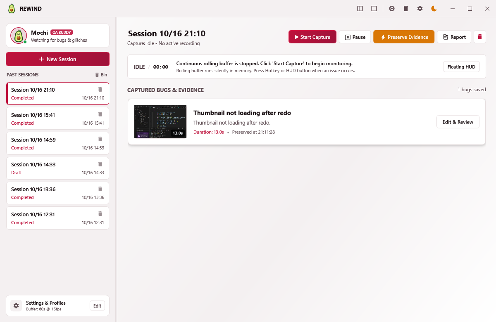
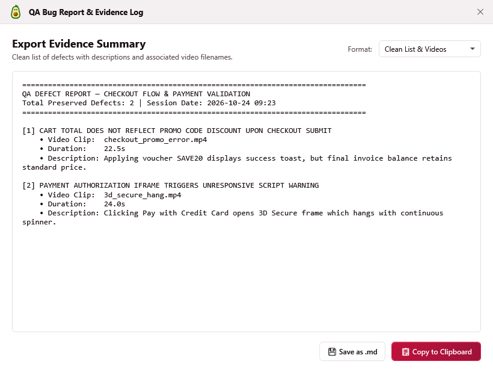
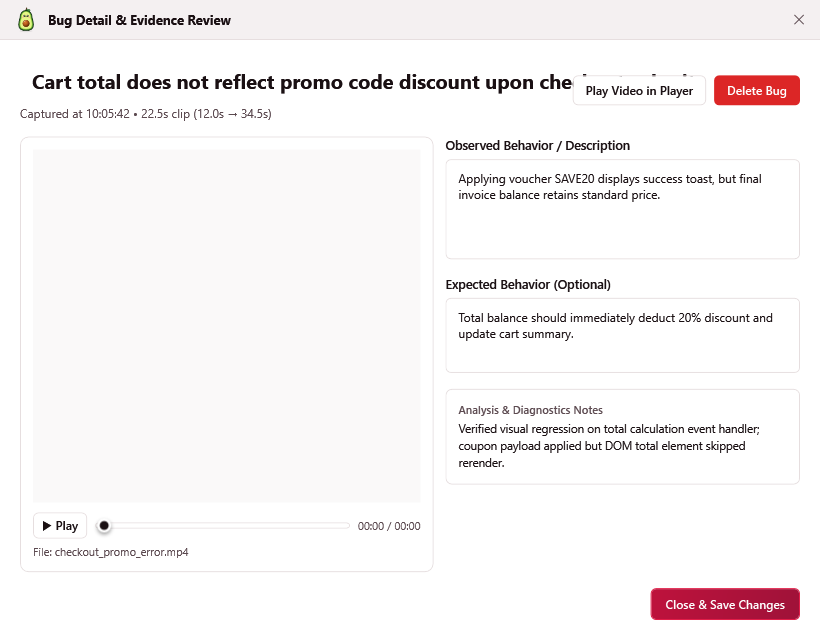
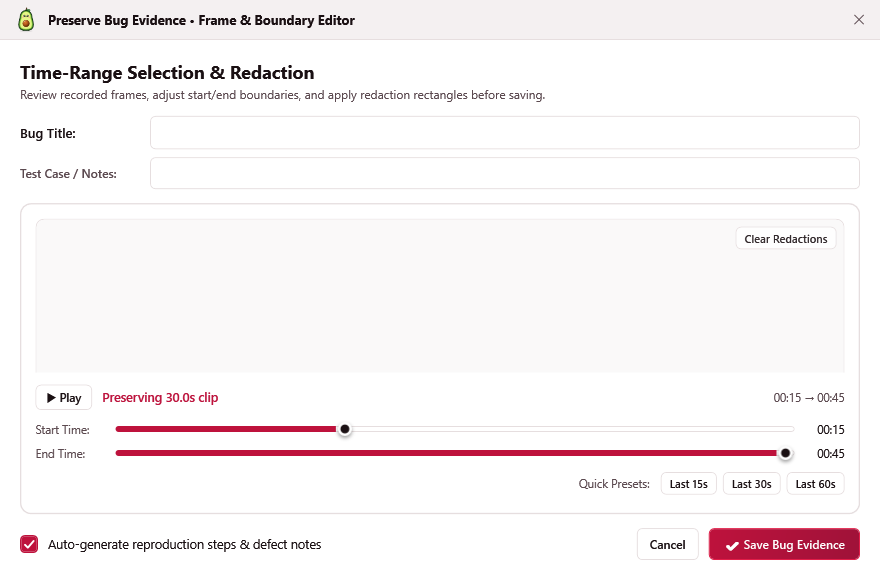
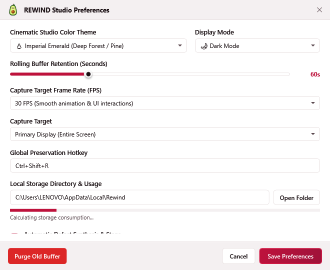
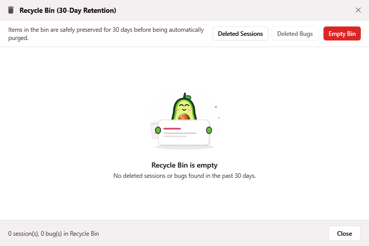

# ⏪ REWIND — Bug Evidence Recorder for QA

<p align="center">
  
</p>

<p align="center">
  <strong>Every bug has a past. Capture it before it disappears.</strong><br>
  <em>Continuous screen preservation, automatic rolling buffer, precision timeline redaction, and instant QA reports.</em>
</p>

<p align="center">
  
  
  
  
</p>

---

## 🌟 Overview

**REWIND** is a local-first desktop application designed specifically for QA engineers, software testers, and developers. It runs silently in the background, continuously maintaining a rolling buffer of your screen. 

When an elusive, intermittent bug occurs, there is **zero need to reproduce it**. Simply tap the global hotkey (`Ctrl+Shift+R`) or hit **⚡ Preserve Bug** on the floating HUD overlay to immortalize the preceding footage into an MP4 clip with full timeline playback, redaction masking, and formatted bug reports.

---

## 📸 Application Screenshots

### 1. Main Studio & Mochi QA Companion
The primary workstation where past test sessions, defect cards, storage footprint metrics, and Mochi (your QA companion mascot) live. Switch color palettes, browse past recordings, play back evidence, or export reports with a single click.

<p align="center">
  
</p>

---

### 2. Instant QA Report Generation & Multi-Export
Preview structured reports before dispatching them to your team. Features an animated loader, multi-format export buttons (**Markdown**, **Jira Markup**, **JSON Data**), copy-to-clipboard shortcuts, and an overview of captured defects.

<p align="center">
  
</p>

---

### 3. Defect Detail & In-App Media Player
Inspect individual bug clips with hardware-accelerated playback, frame scrubber, severity indicators, and AI-assisted defect documentation.

<p align="center">
  
</p>

---

### 4. Precision Timeline Scrubber & Sensitive Data Redaction
Scrub recent footage frame-by-frame with 15s, 30s, and 60s preset buttons. Draw black masking bounding boxes directly over the preview to permanently redact passwords, auth tokens, or PII before encoding.

<p align="center">
  
</p>

---

### 5. Settings, Buffer Control & 10 Distinct Themes
Configure rolling buffer duration (15 to 180 seconds), toggle audio capture, manage AI documentation providers, and personalize your experience with 10 carefully curated themes (Midnight, Emerald, Amethyst, Ocean, Rose, Amber, Coral, Cyan, Slate, and Sunset).

<p align="center">
  
</p>

---

### 6. 30-Day Safe Retention & Recycle Bin
Deleted sessions and bug clips remain restorable for 30 days before permanent deletion, safeguarding your evidence against accidental removal.

<p align="center">
  
</p>

---

### 7. Floating Draggable HUD Overlay
A lightweight, always-on-top HUD with a live recording heartbeat, elapsed timer, and one-click **⚡ Preserve Bug** button.

<p align="center">
  
</p>

---

## ⚡ Core Features

- 🔄 **Continuous Rolling Buffer**: Retains the last 15–180 seconds of screen history with bounded RAM and disk usage (auto-pruned in the background).
- ⚡ **Global Win32 Hotkey (`Ctrl+Shift+R`)**: Preserve the bug instantly from any active application under test without window switching.
- 🐱 **Mochi QA Mascot Companion**: Friendly mascot avatar integrated into the sidebar profile card and report headers.
- 🎨 **10 Curated Color Themes**: Includes Midnight, Emerald, Amethyst, Ocean, Rose, Amber, Coral, Cyan, Slate, and Sunset with full Light/Dark mode support.
- 🛡️ **Zero-Leak Redaction Masking**: Overlay bounding boxes over sensitive credentials, personal customer data, or API keys prior to MP4 compilation.
- 🎬 **Hardware-Accelerated In-App Player**: Embedded video player with scrub controls and timestamps directly inside the bug review window.
- 🤖 **Multi-Provider AI Documentation**:
  - **Offline Local Assistant**: Generates defect summaries with zero internet connection or telemetry.
  - **Google Gemini Multimodal Vision (Opt-in)**: Analyzes evidence frames to draft bug titles, observed anomalies, and reproduction steps.
- 📄 **1-Click Export Formats**:
  - **Markdown (`.md`)** for GitHub, GitLab, and Azure DevOps
  - **Jira Markup** for Atlassian Jira issue trackers
  - **JSON Schema** for CI/CD webhook pipelines and custom bug tracking integrations
- 🗑️ **30-Day Recycle Bin**: Safe deletion and instant one-click recovery.
- 💾 **Local-First SQLite Storage**: All sessions, metadata, tags, and video files stay 100% on your machine (`rewind.db`).

---

## 🏗️ Technical Architecture

| Layer | Technologies |
| :--- | :--- |
| **UI Framework** | .NET 8 WPF (Windows Presentation Foundation) with MVVM pattern |
| **Window Shell** | Custom borderless `WindowChrome` with themed titlebar and drag regions |
| **Screen Capture** | Win32 Desktop Duplication / GDI capture with ring-buffer segmentation |
| **Encoding & Filter Chain** | `ffmpeg` H.264 MP4 encoding with `drawbox` video filters for redactions |
| **Local Database** | SQLite (`Microsoft.Data.Sqlite`) with schema migration & foreign keys |
| **Test Suite** | xUnit automated tests (`Rewind.Tests`) |

---

## 🚀 Getting Started

### Prerequisites

- Windows 10 / 11 (x64)
- [.NET 8 SDK](https://dotnet.microsoft.com/download/dotnet/8.0)
- `ffmpeg` installed and available in your system `PATH`

### Build and Run

```powershell
# Restore dependencies and build solution
dotnet build Rewind.sln

# Run test suite
dotnet test Rewind.sln

# Launch the desktop app
dotnet run --project Rewind.App/Rewind.App.csproj
```

### Self-Contained Release Packaging

To build a standalone executable that runs without requiring a pre-installed .NET runtime:

```powershell
dotnet publish Rewind.App/Rewind.App.csproj -c Release -r win-x64 --self-contained true -p:PublishSingleFile=true -o ./dist
```

---

## ⌨️ Keyboard Shortcuts

| Shortcut | Action | Scope |
| :--- | :--- | :--- |
| `Ctrl + Shift + R` | **⚡ Preserve Bug** (saves rolling buffer clip) | Global (system-wide) |
| `Space` | Play / Pause Video Player | Bug Detail Window |
| `Esc` | Close Preview / Dialog | Active Window |

---

## 📄 License

This project is licensed under the MIT License - see the LICENSE file for details.
